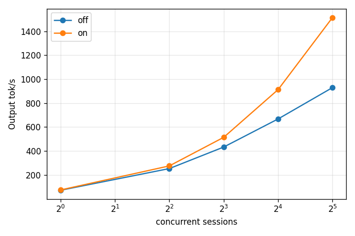
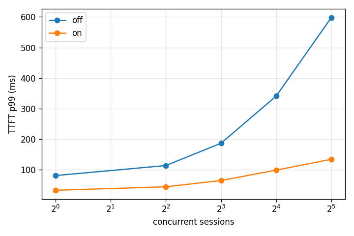
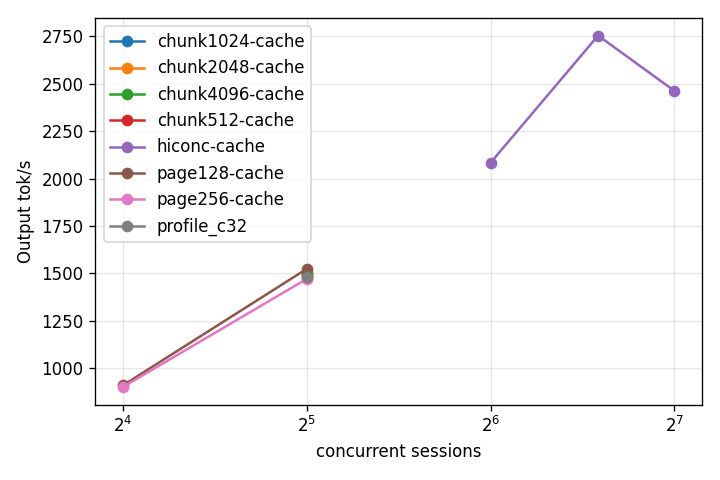

> **TL;DR**
>
> - On one TPU v6e chip, Qwen2.5-7B with SGLang's radix prefix cache does **1,523 output tok/s at 32 agent sessions vs 930 without it (+64%)**, and TTFT p99 drops **598 → 138 ms**. 87% of prompt tokens come from cache and 100% of requests meet a TTFT < 200 ms / ITL < 25 ms SLO.
> - On a **hybrid linear-attention** model (Qwen3.8-27B, v6e-4), the prefix cache made serving **slower at every concurrency**: cache off reached 968 tok/s vs a ~520 tok/s plateau with it on.
> - Against GPUs on the same workload, **H100 wins on speed (1.65–2x)**; v6e-1 roughly **ties A100 on cost** and has the **best tail latency**.
> - Whole study: ~$14 TPU + ~$2 GPU, 11,000+ requests, 0 errors, fully reproducible.

## Why agent workloads are different

Chat benchmarks send one-shot random prompts. Agents don't. Every turn resends the same long system prompt (tool schemas) plus a growing history with each tool result appended. That makes serving speed depend heavily on **prefix-cache reuse**: if the server can skip re-prefilling the shared prefix, time-to-first-token stays flat as sessions grow.

I wanted to know: does SGLang's radix prefix cache deliver that on TPU, and how does TPU compare to GPUs for this pattern?

## Setup

- **Hardware:** Cloud TPU v6e-1 (1 chip, 31.24 GiB HBM) and v6e-4; Modal A100-80GB SXM and H100 SXM for the GPU baseline.
- **Server:** sgl_jax (`sgl-project/sglang-jax`) on TPU; upstream SGLang v0.5.2 on GPU. Shared flags: `--chunked-prefill-size 2048 --mem-fraction-static 0.85 --max-running-requests 128 --enable-cache-report`; cache off = `--disable-radix-cache`.
- **Workload ([agentbench](https://github.com/kitrakrev/sglang-tpu-agentbench), works with any OpenAI-compatible server):** 4 sessions per concurrency level × 6 turns, 600-word shared system prompt, 150-word tool results, 128 max output tokens, temperature 0. Mean prompt ≈ 1,240 tokens.
- **Metrics:** output tok/s, TTFT and ITL percentiles, cached-token %, goodput under an SLO (TTFT < 200 ms and mean ITL < 25 ms per request), $/1M output tokens, and % of the HBM decode roofline.

## Result 1: prefix caching on Qwen2.5-7B, v6e-1

| cache | c | out tok/s | TTFT p50 / p99 ms | ITL p50 ms | cached % | $/1M out (on-demand) |
|---|---|---|---|---|---|---|
| on | 1 | 75 | 30 / 33 | 12.9 | 84.1 | 10.01 |
| on | 8 | 515 | 40 / 65 | 14.5 | 87.7 | 1.46 |
| on | 32 | **1,515** | 42 / **134** | 19.8 | 87.6 | **0.50** |
| off | 1 | 72 | 64 / 81 | 12.9 | 0 | 10.36 |
| off | 8 | 434 | 74 / 187 | 16.9 | 0 | 1.73 |
| off | 32 | 930 | 109 / 598 | 32.4 | 0 | 0.81 |

What stands out:

1. **The benefit grows with concurrency:** +4% tok/s at c=1, +63% at c=32. Without the cache, ~1.2k-token prefills compete with decode and inflate ITL (32 vs 20 ms at c=32).
2. **Hit rate is 84–88% from turn 1**, because the system prompt is shared by every session.
3. **Turn-1 TTFT at high concurrency is a queueing effect**, not a cache effect: all sessions start together.

### Tuning (Run A)

Pushing concurrency: throughput peaks at **2,755 tok/s at c=96** ($0.27/1M on-demand, ~$0.10 spot) and falls at c=128 as the KV pool starts evicting prefixes (hit rate 88% → 75%, TTFT p50 10×). Under the goodput SLO, **c=32 with page size 128 is the best interactive operating point (1,523 tok/s, 100% SLO)**. Page size 256 lowered the hit rate (81% vs 87%); chunked prefill 512–4096 was flat (±1.5%).

### Where the time goes

Decode is HBM-bound. On v6e-1 the per-token floor is weight bytes / HBM bandwidth = 15.2 GB / 1.64 TB/s ≈ 9.3 ms. Measured ITL is 12.9 ms at c=1 (**73% of roofline**) and 19.8 ms at c=32 (55%). Prefix caching skips prefill FLOPs, not decode KV reads, which is why it cuts TTFT 4.5× but barely moves ITL.

## Result 2: when the prefix cache hurts (hybrid linear attention)

Qwen3.8-27B is a hybrid: 48 Gated-DeltaNet (linear-attention) layers + 16 full-attention layers. I served it on v6e-4 with TP=4 (with a merged LoRA adapter).

Getting the cache on at all took work. sgl_jax rejects the plain radix cache for recurrent-state models; it needs `--enable-unified-radix-tree --enable-recurrent-extra-buffer`, and at mem-fraction 0.85 that OOMs at compile. `--mem-fraction-static 0.7 --chunked-prefill-size 1024` works.

| cache | c | out tok/s | TTFT p99 ms | ITL p50 ms | cached % |
|---|---|---|---|---|---|
| off | 1 | 78 | 138 | 12.0 | 0 |
| off | 16 | 655 | 872 | 21.1 | 0 |
| off | 64 | **968** | 3,060 | 55.8 | 0 |
| on | 1 | 36 | 244 | 26.7 | 38.0 |
| on | 16 | 536 | 1,915 | 23.7 | 31.5 |
| on | 64 | 517 | 11,443 | 46.7 | ~0 |

**Cache off wins at every concurrency.** Why:

1. **Hits round down to snapshot boundaries.** A prefix is only reusable where a recurrent-state snapshot exists, so hits land on 1,024-token blocks (the shared system prompt). Hit rate is 32–38% vs 84–88% on the pure-attention model.
2. **Snapshots cost concurrency.** Recurrent-state buffers cut max running requests from 96 to 27, so throughput plateaus at ~520 tok/s and TTFT p99 explodes from queueing.
3. **Extra per-step work:** c=1 ITL doubles (26.7 vs 12.0 ms).

Takeaway: for agent serving on hybrid linear-attention models, the radix cache needs a cheaper recurrent-state checkpoint scheme before it pays off.

## Result 3: TPU v6e-1 vs A100 vs H100

Same workload and flags, Qwen2.5-7B, radix cache on.

| c | device | out tok/s | TTFT p99 ms | ITL p50 ms | SLO % | $/1M out | % roofline |
|---|---|---|---|---|---|---|---|
| 1 | v6e-1 | 75 | 33 | 12.9 | 100 | 10.01 | 73% |
| 1 | A100 | 90 | 51 | 10.3 | 100 | 7.69 | 73% |
| 1 | H100 | **149** | 33 | **6.2** | 100 | 7.34 | 74% |
| 32 | v6e-1 | 1,515 | **134** | 19.8 | **100** | 0.50 | **55%** |
| 32 | A100 | 1,548 | 410 | 18.9 | 96.7 | 0.45 | 46% |
| 32 | H100 | **2,502** | 529 | **11.1** | 96.4 | **0.44** | 48% |
| 96 | v6e-1 | 2,755 | 520 | 30.1 | 7.4 | 0.27 | 46% |
| 96 | A100 | 3,001 | 821 | 26.3 | 5.3 | 0.23 | 43% |
| 96 | H100 | **5,197** | 618 | **13.2** | 31.5 | **0.21** | 52% |

Prices: Modal on-demand A100-80GB $2.50/h, H100 $3.95/h; GCP v6e $2.70/chip-h.

The honest read:

1. **H100 wins outright:** 1.65–2.0× v6e-1 throughput, about half the ITL, and the lowest $/1M at every concurrency despite costing 1.46× per hour.
2. **A100 vs v6e-1 is roughly a tie.** A100 has slightly more tok/s and 10–23% lower $/1M; v6e-1 has clearly better tail TTFT (134 vs 410 ms p99 at c=32) and is the only device at 100% SLO there. With the cache off, v6e-1 beats A100 from c=8 up.
3. **Per HBM byte, all three land in the same place:** ~73% of roofline at c=1. The H100 gap is mostly bandwidth (3.35 vs 1.64 TB/s), not software.
4. **Caveats:** mature SGLang CUDA (CUDA graphs) vs young sgl_jax; page size 1 on GPU vs 128 on TPU; neither server tuned per platform beyond the shared flags.

## Cost and reproducibility

The whole study cost about **$14 of TPU time and $2 of GPU time**. The repo has every log, metrics table and chart, plus `REPRODUCE.md` with step-by-step instructions for both TPU (GCP setup, budget kill-switch, VM create/delete, each run) and GPU (Modal).

**Code, logs and reproduce steps:** [github.com/kitrakrev/sglang-tpu-agentbench](https://github.com/kitrakrev/sglang-tpu-agentbench)

## What's next

- v6e-8 with Qwen2.5-72B (no spot capacity during this sprint).
- EAGLE3 speculative decoding for agent turns.
- Host-memory KV offload and longer sessions (20+ turns), where per-session history dominates.

*Built for the #TorchTPUSprint.*
