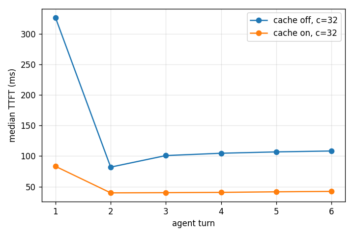
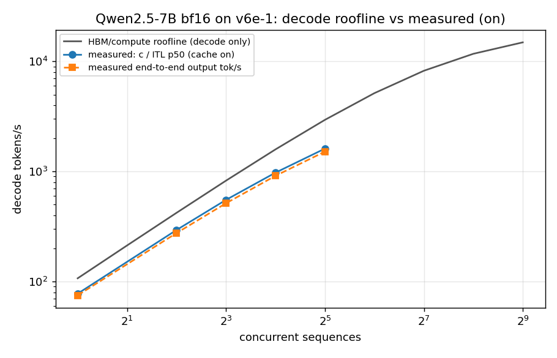
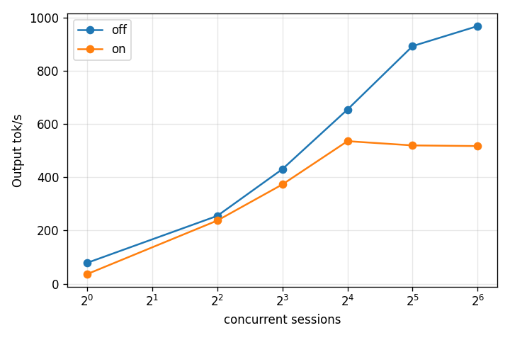
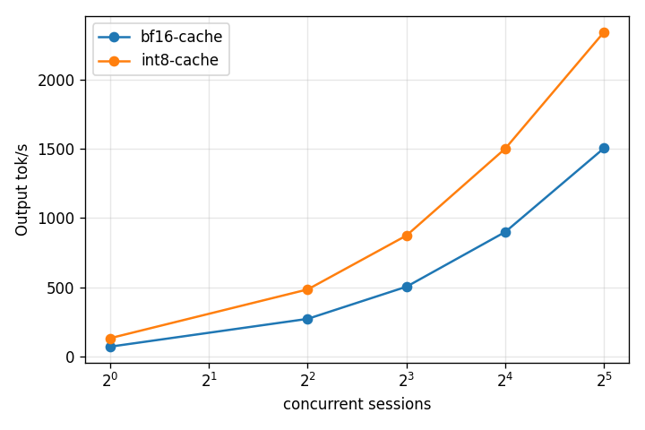
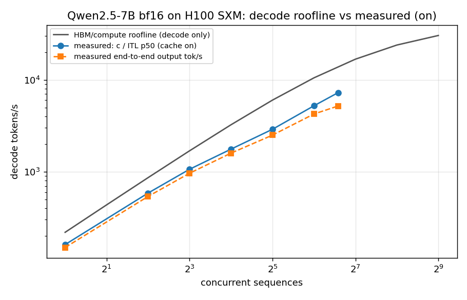

> **TL;DR.** On one TPU v6e chip, SGLang's radix prefix cache lifts Qwen2.5-7B from **930 to 1,523 output tok/s** at 32 agent sessions and cuts TTFT p99 from **598 to 138 ms**, with 100% of requests inside a 200 ms TTFT SLO. On a hybrid linear-attention model (Qwen3.8-27B) the same cache made serving **slower at every concurrency**, and int8 weights add another **1.55x** on top (2,342 tok/s at c=32). H100 is 1.65 to 2x faster, while v6e-1 roughly ties A100 on cost and has the best tail latency.

The whole study cost about $20 of TPU time and $2 of GPU time: 15,000+ requests, 0 errors, all logs and scripts public. Along the way I ported five model families to sgl_jax and opened three of them upstream.

## Why agent serving on TPU

Chat benchmarks send one-shot random prompts. Agents do not. Every turn resends the same long system prompt (tool schemas) plus a growing history with each tool result appended.

So serving speed depends on **prefix-cache reuse**. If the server can skip re-prefilling the shared prefix, time-to-first-token stays flat as sessions grow. I wanted two answers:

1. Does SGLang's radix cache deliver that on TPU through sgl_jax, the JAX port?
2. How does a TPU v6e compare to an A100 or H100 on this pattern, in speed and in dollars?

## Setup

| | |
|---|---|
| **TPU** | Cloud TPU v6e-1 (1 chip, 31.24 GiB HBM) and v6e-4 |
| **GPU** | Modal A100-80GB SXM and H100 SXM |
| **Server** | sgl_jax (`sgl-project/sglang-jax`) on TPU; SGLang v0.5.2 on GPU |
| **Workload** | 4 sessions per concurrency level x 6 turns, 600-word shared system prompt, 150-word tool results, 128 max output tokens, temperature 0. Mean prompt about 1,240 tokens |
| **SLO** | TTFT < 200 ms and mean ITL < 25 ms per request |

Shared server flags:

```bash
--chunked-prefill-size 2048 --mem-fraction-static 0.85 \
--max-running-requests 128 --enable-cache-report
# cache off: add --disable-radix-cache
```

The client, [agentbench](https://github.com/kitrakrev/sglang-tpu-agentbench), works with any OpenAI-compatible server. It reports output tok/s, TTFT and ITL percentiles, cached-token share, goodput under the SLO, $/1M output tokens and percent of the HBM decode roofline.

## Run A: prefix caching on Qwen2.5-7B, v6e-1

| cache | c | tok/s | TTFT p50 / p99 (ms) | ITL p50 (ms) | cached | $/1M out |
|---|--:|--:|--:|--:|--:|--:|
| on | 1 | 75 | 30 / 33 | 12.9 | 84% | 10.01 |
| on | 8 | 515 | 40 / 65 | 14.5 | 88% | 1.46 |
| on | 32 | **1,515** | 42 / **134** | 19.8 | 88% | **0.50** |
| off | 1 | 72 | 64 / 81 | 12.9 | 0% | 10.36 |
| off | 8 | 434 | 74 / 187 | 16.9 | 0% | 1.73 |
| off | 32 | 930 | 109 / 598 | 32.4 | 0% | 0.81 |


*Output throughput on v6e-1, cache on vs off.*

Three things stand out:

- **The benefit grows with concurrency.** It is +4% at c=1 and +63% at c=32. Without the cache, 1.2k-token prefills compete with decode and push ITL from 20 to 32 ms.
- **Hit rate is 84 to 88% from turn 1**, because every session shares the system prompt.
- **High turn-1 TTFT is queueing, not cache misses.** All sessions start at the same moment.


*TTFT p99. The cache keeps the tail flat as concurrency rises.*


*TTFT per turn. Turn 1 is a queueing spike.*

### Tuning

Throughput peaks at **2,755 tok/s at c=96** ($0.27/1M on-demand, about $0.10 spot). At c=128 the KV pool starts evicting prefixes: hit rate falls from 88% to 75% and TTFT p50 grows 10x.

Under the SLO, **c=32 with page size 128 is the best interactive point: 1,523 tok/s with 100% of requests in SLO.** Page size 256 lowered the hit rate (81% vs 87%). Chunked prefill from 512 to 4096 made no difference (within 1.5%).


*Concurrency sweep. Throughput peaks at c=96, then KV eviction sets in.*

### Where the time goes

Decode is HBM-bound. The per-token floor on v6e-1 is weight bytes over bandwidth: 15.2 GB / 1.64 TB/s = 9.3 ms. Measured ITL is 12.9 ms at c=1 (**73% of roofline**) and 19.8 ms at c=32 (55%).

Prefix caching skips prefill FLOPs, not decode KV reads. That is why it cuts TTFT 4.5x but barely moves ITL.


*Measured ITL against the HBM bandwidth floor.*

## Run B: Qwen3.8-27B on v6e-4, where the cache hurts

Qwen3.8-27B is a hybrid: 48 Gated-DeltaNet (linear-attention) layers and 16 full-attention layers. I served it on v6e-4 with TP=4 and a merged LoRA adapter.

Turning the cache on took work. sgl_jax rejects the plain radix cache for recurrent-state models. It needs `--enable-unified-radix-tree --enable-recurrent-extra-buffer`, which OOMs at compile with mem-fraction 0.85. Dropping to `--mem-fraction-static 0.7 --chunked-prefill-size 1024` works.

| cache | c | tok/s | TTFT p99 (ms) | ITL p50 (ms) | cached |
|---|--:|--:|--:|--:|--:|
| off | 1 | 78 | 138 | 12.0 | 0% |
| off | 16 | 655 | 872 | 21.1 | 0% |
| off | 64 | **968** | 3,060 | 55.8 | 0% |
| on | 1 | 36 | 244 | 26.7 | 38% |
| on | 16 | 536 | 1,915 | 23.7 | 32% |
| on | 64 | 517 | 11,443 | 46.7 | ~0% |


*Qwen3.8-27B on v6e-4. Cache off wins at every concurrency.*

Cache off wins everywhere, for three reasons:

1. **Hits round down to snapshot boundaries.** A prefix is reusable only where a recurrent-state snapshot exists, so hits land on 1,024-token blocks. Hit rate is 32 to 38%, against 84 to 88% on the pure-attention model.
2. **Snapshots cost concurrency.** The state buffers cut max running requests from 96 to 27. Throughput plateaus near 520 tok/s and TTFT p99 explodes from queueing.
3. **Extra per-step work.** ITL at c=1 doubles, from 12.0 to 26.7 ms.

For hybrid linear-attention models, the radix cache needs a cheaper recurrent-state checkpoint before it pays off. Until then, turn it off.

## Run C: int8 weights and OLMo ports

### int8 weights

sgl_jax ships an int8 weight-only config (`--quantization-config-path=int8.yaml`): per-channel int8 weights, bf16 activations and KV cache, quantized at load. Same v6e-1, same workload, cache on, with the bf16 baseline re-run on the same build.

| c | bf16 tok/s | int8 tok/s | bf16 ITL p50 (ms) | int8 ITL p50 (ms) |
|--:|--:|--:|--:|--:|
| 1 | 74 | **135** | 13.0 | **7.1** |
| 8 | 506 | **875** | 14.7 | **8.5** |
| 32 | 1,505 | **2,342** | 20.1 | **12.9** |


*int8 weight-only vs bf16 on v6e-1.*

Halving weight bytes nearly halves per-token latency (1.84x faster decode at c=1), since decode is HBM-bound. The freed memory also grows the KV pool from 232k to 345k tokens. Cost at c=32 drops from $0.50 to about $0.32 per 1M output tokens.

I did not run an accuracy eval on the int8 model, so treat this as a speed result only.

### OLMo 2 and Olmo 3

sgl_jax did not support AI2's fully open OLMo models, so I added them on a [fork branch](https://github.com/kitrakrev/sglang-jax/tree/add-olmo3-support):

- **OLMo 2:** post-sublayer RMSNorm and full-width QK-norm.
- **Olmo 3:** the same block plus 3:1 interleaved sliding-window attention (window 4096) and YaRN RoPE, plugged into sgl_jax's hybrid SWA KV pool.

Against HF transformers on CPU (tiny random fp32 models), the worst prompt-logprob difference is 2.9e-6 for OLMo 2 and 1.9e-6 for Olmo 3, with identical greedy tokens. On TPU both served the full agent workload with 0 errors.

| model (v6e-1, cache on) | TTFT p50, c=1 | ITL p50, c=1 | tok/s, c=32 |
|---|--:|--:|--:|
| Qwen2.5-7B | 30 ms | 13.0 ms | 1,505 |
| OLMo-2-7B | 219 ms | 13.4 ms | 162 |
| Olmo-3-7B | 124 ms | 13.4 ms | 65 |

Decode matches Qwen. Prefill is 10 to 30x slower, and throughput collapses under load.

The logs show why. OLMo 7B uses full multi-head attention: 32 KV heads against 4 for Qwen. The TPU ragged paged attention kernel has no tuned block sizes for that shape on v6e, so its fallback picks a query block of 2 (vs 32 for Qwen) and each prefill chunk takes 1 to 2 seconds. MHA also makes the KV cache 8x larger per token. This is kernel tuning, not model correctness.

## TPU vs A100 vs H100: speed and cost

Same workload and flags, Qwen2.5-7B, radix cache on. Prices are on-demand: GCP v6e $2.70/chip-h, Modal A100-80GB $2.50/h, H100 $3.95/h.

| c | device | tok/s | TTFT p99 (ms) | ITL p50 (ms) | in SLO | $/1M out | roofline |
|--:|---|--:|--:|--:|--:|--:|--:|
| 1 | v6e-1 | 75 | 33 | 12.9 | 100% | 10.01 | 73% |
| 1 | A100 | 90 | 51 | 10.3 | 100% | 7.69 | 73% |
| 1 | H100 | **149** | 33 | **6.2** | 100% | 7.34 | 74% |
| 32 | v6e-1 | 1,515 | **134** | 19.8 | **100%** | 0.50 | **55%** |
| 32 | A100 | 1,548 | 410 | 18.9 | 96.7% | 0.45 | 46% |
| 32 | H100 | **2,502** | 529 | **11.1** | 96.4% | **0.44** | 48% |
| 96 | v6e-1 | 2,755 | 520 | 30.1 | 7.4% | 0.27 | 46% |
| 96 | A100 | 3,001 | 821 | 26.3 | 5.3% | 0.23 | 43% |
| 96 | H100 | **5,197** | 618 | **13.2** | 31.5% | **0.21** | 52% |


*H100 decode against its HBM floor.*

My read:

- **H100 wins outright.** It has 1.65 to 2x the v6e-1 throughput, about half the ITL, and the lowest $/1M at every concurrency despite costing 1.46x per hour.
- **A100 vs v6e-1 is roughly a tie.** A100 has slightly more tok/s and 10 to 23% lower $/1M. v6e-1 has much better tail TTFT (134 vs 410 ms p99 at c=32) and is the only device at 100% SLO there. With the cache off, v6e-1 beats A100 from c=8 up.
- **Per HBM byte, all three are the same.** Each sits near 73% of roofline at c=1. The H100 gap is mostly bandwidth (3.35 vs 1.64 TB/s), not software.

Caveats: mature SGLang CUDA (with CUDA graphs) against a young sgl_jax; page size 1 on GPU vs 128 on TPU; no per-platform tuning beyond the shared flags.

## Upstream contributions

Beyond OLMo, I ported four more model families that upstream sgl_jax lacked: Gemma 3 (text), GLM-4, InternVL 3 and Qwen2-Audio. Gemma 3 text already has an open PR upstream, so I did not open a competing one. The other three are now open pull requests on `sgl-project/sglang-jax`:

| PR | Model | What it adds |
|---|---|---|
| [#1829](https://github.com/sgl-project/sglang-jax/pull/1829) | GLM-4 dense | Sandwich norms, fused `gate_up_proj` split at load, partial interleaved RoPE, q/k/v bias |
| [#1830](https://github.com/sgl-project/sglang-jax/pull/1830) | InternVL 3 | InternViT encoder, pixel shuffle and MLP projector on the existing Qwen2 backbone |
| [#1831](https://github.com/sgl-project/sglang-jax/pull/1831) | Qwen2-Audio | Whisper-style encoder with padded-frame masking; the first mel-spectrogram input on the in-model multimodal path |

Each port is checked the same way. On CPU, tiny random fp32 checkpoints run through the full engine and must produce identical greedy tokens to HF transformers. The worst logprob gap is 2.9e-6 for GLM-4 and InternVL 3 and 2.0e-5 for Qwen2-Audio. Negative controls (for example, the wrong RoPE style for GLM-4) must fail. The same checks are committed as tests on each branch.

On a real v6e-1:

- **GLM-4-9B** serves the agent workload at 739 tok/s at c=16, ITL p50 20.4 ms.
- **InternVL3-2B**, with 3,328 image tokens per request, reaches 177 tok/s at c=1 with TTFT p50 258 ms.
- **Qwen2-Audio-7B**, with a 10 s clip per request, reaches 72 tok/s at c=1 with TTFT p50 129 ms.

One trap: the first multimodal pass, which warmed only one batch shape, hit XLA compile stalls of up to 52 s TTFT p99 when a new shape appeared. Warm every shape you plan to serve.

## Lessons

- **Measure the cache on your model, not in general.** The same flag gave +64% on a pure-attention model and nearly halved throughput on a hybrid one.
- **Decode is a bandwidth problem.** Roofline math predicted the int8 win and the H100 gap before I ran them.
- **Kernel tile tables matter as much as model code.** OLMo was numerically correct and still 10 to 30x slower at prefill because of one missing tile config.
- **Report goodput, not just throughput.** v6e-1 loses to A100 on raw tok/s at c=32 but is the only device that keeps every request inside the SLO.
- **Plan for TPU capacity.** I wanted Qwen2.5-72B on a v6e-8 and found none, spot or on-demand, across six zones over two days. A spot v6e-1 was also preempted mid-run. Keep on-demand fallbacks and expect to retry.

Next on my list: tuned attention tiles for 32-KV-head models, an accuracy eval for int8 plus int8 KV cache, EAGLE3 speculative decoding, and longer sessions (20+ turns) with host-memory KV offload.

## Reproduce

Everything is in [github.com/kitrakrev/sglang-tpu-agentbench](https://github.com/kitrakrev/sglang-tpu-agentbench): every log, metrics table and chart. `REPRODUCE.md` walks through both sides step by step:

- **TPU:** GCP setup, a budget kill-switch, VM create and delete, and each run.
- **GPU:** Modal scripts for the A100 and H100 baselines.
- **Ports:** `PORTS.md` has the parity scripts, throughput tables and the TPU vs GPU numbers for each new model.

*Built for the #TorchTPUSprint.*
